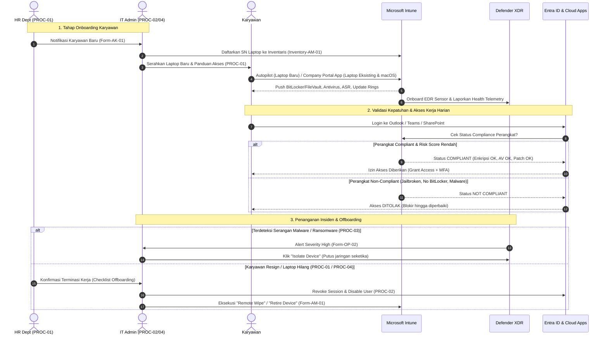

# PANDUAN LENGKAP & CHECKLIST IMPLEMENTASI ISO/IEC 27001:2022 PADA ENDPOINT (WINDOWS & MACOS)
## Integrasi Microsoft Intune, Microsoft Defender XDR, Kebijakan GOV-POL-TK3I & Seluruh Prosedur Operasional (PROC-01 s/d PROC-09)
### PT ECOMINDO SARANA CIPTA

---

## 1. PENDAHULUAN & RUANG LINGKUP (SCOPE)

Dokumen ini merupakan panduan implementasi teknis, checklist kepatuhan, dan integrasi tata kelola **ISO/IEC 27001:2022** khusus untuk pengamanan perangkat akhir (*user endpoint devices* / laptop karyawan) berbasis **Windows 10/11** dan **macOS** (macOS Ventura, Sonoma, Sequoia) di lingkungan **PT Ecomindo Sarana Cipta**.

Implementasi ini menjembatani dokumen tata kelola tingkat tinggi (**GOV-POL-TK3I**), seluruh prosedur operasional standar (**PROC-01 s/d PROC-09**), dengan eksekusi teknis otomatisasi cloud:
1. **Microsoft Intune (Endpoint Manager)**: Sebagai platform *Mobile Device Management* (MDM) / *Mobile Application Management* (MAM) untuk penegakan konfigurasi baseline, kepatuhan, enkripsi, dan pembatasan media.
2. **Microsoft Defender XDR (Defender for Endpoint / MDE)**: Sebagai platform *Endpoint Detection & Response* (EDR), *Next-Generation Antivirus* (NGAV), *Attack Surface Reduction* (ASR), dan *Vulnerability Management*.
3. **Microsoft Entra ID (Azure AD)**: Sebagai pengendali identitas, otentikasi berbasis risiko, penyimpanan kunci enkripsi (*key escrow*), dan penegakan akses bersyarat (*Conditional Access*).

---

## 2. PETA KORELASI KEBIJAKAN (GOV-POL), PROSEDUR (PROC) & KONTROL TEKNIS

| Area Kebijakan (GOV-POL-TK3I) | Dokumen Prosedur Terkait | Kontrol ISO 27001:2022 | Implementasi Teknis pada Laptop (Intune & Defender XDR) | Formulir / Evidence Dokumen |
|:---|:---|:---|:---|:---|
| **Area 1: Manajemen Risiko** | **PROC-07** Manajemen Risiko | A.8.1, A.8.8, A.8.16 | Defender Vulnerability Management (Exposure Score), Mitigasi risiko endpoint hilang/terinfeksi malware | `Form-RM-01` (Risk Register), Laporan TVM |
| **Area 2: Kebijakan Umum & Baseline** | **PROC-03** Keamanan Operasi | A.8.9 Configuration Management | CIS Windows 11 & CIS macOS Hardening via Intune Settings Catalog | Export Baseline Profile Intune |
| **Area 3: Organisasi & Awareness** | **PROC-06** Kesadaran & Kepatuhan | A.6.3 Information security awareness | Defender Phishing Simulation, Web Content Filtering anti-phishing, safe browsing | `Form-AC-01` (Pengakuan Pelatihan), Log Web Protection |
| **Area 4: Keamanan SDM & Lifecycle** | **PROC-01** HR & Ketenagakerjaan | A.6.1, A.6.2, A.6.5 | Penyerahan laptop saat onboarding via Autopilot/Company Portal; Remote wipe seketika saat offboarding | Checklist Terminasi Karyawan, Log Intune Device Wipe |
| **Area 5: Manajemen Aset & Proteksi Data** | **PROC-04** Manajemen Aset | A.5.9, A.8.1, A.8.12, A.8.24 | BitLocker/FileVault AES-256 disk encryption, USB Device Control (Block Write/Read-Only), Inventarisasi otomatis | `Inventory-AM-01` (Aset TI), `Form-AM-01` (Pembuangan Aset) |
| **Area 6: Pengendalian Akses & IAM** | **PROC-02** Pengendalian Akses | A.5.15, A.5.16, A.5.17, A.5.18 | Windows LAPS (anti-shared local admin), Password min 12 karakter, Screen Lock timeout 10 menit, MFA + Conditional Access | `Form-AK-01` (Akses Baru), Log Entra LAPS & Sign-in |
| **Area 7: Keamanan Fisik & WFH** | **PROC-05** Keamanan Fisik | A.7.7 Clear desk/screen, A.6.7 Remote working | Screen Saver Lock otomatis 10 menit, Enkripsi wajib untuk laptop WFH, remote isolation jika perangkat dicuri | `Daftar Periksa-PS-01`, Laporan Audit WFH |
| **Area 8: Keamanan Operasional** | **PROC-03** Keamanan Operasi | A.8.7 Anti-malware, A.8.8 Patching, A.8.16 Logging | Real-time AV, EDR Cloud Protection, ASR Rules, Windows & macOS Update Rings (Deadline ≤ 7-14 hari) | `Form-OP-01` (RFC Patch), Log Antivirus, MDE Alerts |
| **Area 9: Keamanan Cloud & Integrasi** | **PROC-09** Keamanan Cloud | A.5.23 Cloud services, A.8.20 Network security | Host-based Firewall (Domain, Private, Public), Intune-to-MDE Cloud Connector, Enforce Compliant Device | `Form-CS-01` (Onboarding Cloud), Conditional Access Policy |
| **Area 10: Kontinuitas Bisnis & DRP** | **PROC-08** BCP & DRP | A.8.14 Redundancy, A.8.10 Data deletion | Sinkronisasi folder profil user ke OneDrive for Business (KFM), Cloud-based Rapid Device Re-provisioning | `Form-BC-01` (BIA), Laporan Uji DRP Laptop |

---

## 3. MASTER CHECKLIST KONTROL TEKNIS LAPTOP (WINDOWS & MACOS)

Gunakan checklist ini sebagai panduan verifikasi berkala (self-assessment & audit internal):

| ID | Sasaran Keamanan | Windows 10/11 | macOS (Ventura/Sonoma/Sequoia) | Rujukan Kebijakan & Prosedur | Status |
|:---:|:---|:---|:---|:---|:---:|
| **CHK-01** | **Inventarisasi & Enrollment Terpusat** | Terdaftar di Microsoft Entra ID & Intune via Windows Autopilot (baru) atau Company Portal App (eksisting) | Terdaftar di Intune via Apple ADE (baru) atau Company Portal App (eksisting) | **GOV-POL Area 5** **PROC-04** (2.1) **PROC-01** (Checklist Onboarding) | [ ] |
| **CHK-02** | **Full-Disk Encryption (At-Rest)** | BitLocker aktif (XTS-AES 256-bit), TPM 2.0 wajib, Recovery Key escrow ke Entra ID | FileVault aktif (AES-256), Personal Recovery Key escrow ke Intune, rotasi otomatis | **GOV-POL Area 5** **PROC-04** (2.3) **PROC-02** (Standar Enkripsi) | [ ] |
| **CHK-03** | **Anti-Malware & Real-Time Protection** | Microsoft Defender Antivirus: Real-time ON, Cloud protection High, PUA Protection Block, Tamper Protection ON | Defender for Endpoint daemon aktif, Real-time scan ON, RTP ON, System Extension approved | **GOV-POL Area 8** **PROC-03** (2.3 Proteksi Malware) | [ ] |
| **CHK-04** | **Endpoint Detection & Response (EDR)** | MDE Sensor aktif (Onboarded via Intune connector), Telemetry frequency accelerated | MDE Sensor onboarded via MobileConfig profile, Full Disk Access (FDA) approved | **GOV-POL Area 8** **PROC-03** (2.2 Logging & Monitoring) | [ ] |
| **CHK-05** | **Attack Surface Reduction (ASR)** | Minimal 8 ASR Rules diset ke mode **Block** (anti-ransomware, credential theft lsass, Office child process) | Gatekeeper: Mac App Store & Identified Developers only, Execution Restriction | **GOV-POL Area 2 & 8** **PROC-03** (2.3) | [ ] |
| **CHK-06** | **Manajemen Patch & Vulnerability** | Windows Update Rings: Quality Update deferral 0-2 hari, deadline 7 hari, auto-restart | macOS Update Policy: Download & install otomatis di luar jam kerja, deferral max 14 hari | **GOV-POL Area 8** **PROC-03** (2.4 Patch Manajemen) | [ ] |
| **CHK-07** | **Password & Otentikasi** | Min 12 karakter (kombinasi huruf, angka, simbol), masa berlaku 90 hari, Windows Hello for Business PIN terproteksi TPM | Min 12 karakter, kompleksitas aktif, Touch ID terikat enkripsi Secure Enclave | **GOV-POL Area 6** **PROC-02** (Standar Password) | [ ] |
| **CHK-08** | **Screen Lock & Clear Screen** | Inactivity timeout maksimal 10 menit, langsung minta password saat layar hidup | Inactivity timeout maksimal 10 menit, ask password delay = 0 detik | **GOV-POL Area 6 & 7** **PROC-05** (2.2 & 2.5 WFH) **PROC-02** (2.6) | [ ] |
| **CHK-09** | **Hak Akses Lokal (Least Privilege)** | User operasional adalah **Standard User**. Akun Administrator dikelola via **Windows LAPS** (rotasi 30 hari) | User operasional adalah **Standard User**. Akun admin lokal dikelola terpisah dan didelegasikan | **GOV-POL Area 6** **PROC-02** (2.1 & 2.3) **STD-SoD** | [ ] |
| **CHK-10** | **Pencegahan Kebocoran Data (USB DLP)** | Removable Storage Block Write atau Read-Only. Autorun/Autoplay dinonaktifkan total | Media Management Disc Burning: Burn Support diset "Off" / "Authenticate", pembatasan USB via MDE Device Control | **GOV-POL Area 5** **PROC-03** (2.3 USB Media) **PROC-04** (2.3) | [ ] |
| **CHK-11** | **Host Firewall & Network Security** | Windows Defender Firewall aktif pada profil Domain, Private, dan Public | macOS Application Firewall aktif, Stealth Mode aktif | **GOV-POL Area 8** **PROC-03** (2.7 Pengamanan Jaringan) | [ ] |
| **CHK-12** | **Web Protection & Filtering** | Network Protection aktif, Web Content Filtering: Blokir Phishing, Adult, High-Liability, Perjudian | Web Protection Network Filter Extension aktif di macOS | **GOV-POL Area 3 & 8** **PROC-06** (2.1) **PROC-03** (2.3) | [ ] |
| **CHK-13** | **Conditional Access Enforcement** | Akses ke seluruh layanan cloud korporat (M365, AWS, Github) WAJIB berasal dari perangkat berstatus **Compliant** | Sama (macOS Compliant via Intune Company Portal) | **GOV-POL Area 6 & 9** **PROC-09** (2.1) **PROC-02** (2.6) | [ ] |
| **CHK-14** | **Sanitasi Data & Penanganan Insiden** | Kemampuan eksekusi **Isolate Device** (isolasi jaringan jika malware) dan **Remote Wipe** (jika hilang/offboarding) | Kemampuan eksekusi **Isolate Device** dan **Remote Erase / Retire** via Intune | **GOV-POL Area 4, 5 & 8** **PROC-01** (Terminasi) **PROC-04** (2.4 Pembuangan) | [ ] |

---

## 4. PRASYARAT INTEGRASI & KONEKSI CLOUD

### 4.1 Lisensi & Hak Akses
- **Lisensi**: Microsoft 365 E5, atau Microsoft 365 E3 + Microsoft Defender for Endpoint P2, atau Microsoft 365 Business Premium.
- **Kredensial Admin**: Role *Intune Administrator*, *Security Administrator*, dan *Privileged Role Administrator* (hanya saat setup konektor awal).
- **Sertifikat Apple APNs**: Wajib aktif di Microsoft Intune untuk manajemen macOS (`intune.microsoft.com` > **Devices** > **macOS** > **Apple MDM Push certificate**).

### 4.2 Mengaktifkan Intune-to-Defender Service Connector
Langkah ini menghubungkan sensor Defender XDR dengan mesin kalkulasi *Device Compliance* di Intune (Pemenuhan **PROC-09 Cloud Security & Shared Responsibility**):
1. Buka **Microsoft Defender Portal** (`https://security.microsoft.com`).
2. Masuk ke **Settings** > **Endpoints** > **Advanced features**.
3. Cari toggle **Microsoft Intune connection** dan geser ke **On**.
4. Klik **Save preferences**.
5. Masuk ke **Microsoft Intune admin center** (`https://intune.microsoft.com`).
6. Masuk ke **Endpoint security** > **Microsoft Defender for Endpoint**.
7. Setel konfigurasi berikut ke **On**:
   - `Connect Windows devices to Microsoft Defender for Endpoint` : **On**
   - `Connect macOS devices to Microsoft Defender for Endpoint` : **On**
   - `Allow Microsoft Defender for Endpoint to enforce Endpoint Security Configurations` : **On**
8. Klik **Save**.

---

## 5. LANGKAH IMPLEMENTASI TEKNIS: MICROSOFT INTUNE

---

### 5.1 Onboarding & Inventarisasi Aset (Korelasi: PROC-01, PROC-04 & ISO A.8.1)

Setiap laptop yang digunakan karyawan wajib terdaftar di inventaris resmi perusahaan sebelum diberikan izin akses.

#### A. Windows 10/11 (Windows Autopilot / Entra Join):
1. **Untuk Laptop Pengadaan Baru (Corporate Owned)**:
   - Dapatkan *Hardware Hash* dari vendor atau jalankan script PowerShell `Get-WindowsAutopilotInfo.ps1 -Online`.
   - Upload ke Intune > **Devices** > **Enrollment** > **Windows Autopilot Deployment Program** > **Devices**.
   - Buat Deployment Profile: User-Driven Mode, Microsoft Entra Joined, Standard User account type (bukan Administrator).
2. **Untuk Laptop Eksisting (Metode Standar Resmi: Aplikasi Company Portal)**:
   > [!NOTE]
   > Karena **lingkup (scope) audit ISO 27001 bersifat terbatas** dan pengaturan *Mobility (MDM and WIP)* di Entra ID tidak perlu dibuka untuk seluruh organisasi, **Aplikasi Company Portal (Portal Perusahaan) ditetapkan sebagai metode standar resmi** untuk pendaftaran seluruh laptop eksisting. Metode ini melakukan direct-enrollment secara individual hanya untuk karyawan dalam scope ISO, tanpa mempengaruhi perangkat karyawan lain di luar lingkup.

   - **Langkah-Langkah Pendaftaran via Company Portal**:
     1. Karyawan membuka **Microsoft Store** di laptop Windows.
     2. Cari dan pasang aplikasi resmi: **Company Portal** *(Portal Perusahaan oleh Microsoft Corporation)*.
     3. Buka aplikasi **Company Portal** > Login menggunakan email resmi `@ecomindo.com` (akun yang masuk scope ISO).
     4. Aplikasi akan mendeteksi status perangkat dan menampilkan prompt:
        > *"This device has not been registered yet. Click here to set up your device."*
     5. Klik tombol **Set up** / **Register** dan ikuti panduan persetujuan 2 langkah di layar.
     6. Tunggu proses pendaftaran hingga muncul tanda centang hijau:
        > *"You're all set! This device is now managed by PT Ecomindo Sarana Cipta."*
   
   - **Verifikasi Keberhasilan di Sisi Laptop**:
     1. Buka **Settings** > **Accounts** > **Access work or school**.
     2. Klik akun `@ecomindo.com` yang terhubung.
     3. **Pastikan tombol `Info` muncul di sebelah tombol `Disconnect`** (tanda valid bahwa koneksi MDM Intune telah aktif).
     4. Klik **`Info`** > scroll ke bawah > klik tombol **`Sync`** untuk mempercepat penarikan kebijakan keamanan.
     5. Dalam waktu 2–5 menit, laptop otomatis muncul pada konsol Intune (**Devices** > **Windows devices**) dan dapat dicatat pada formulir `Inventory-AM-01` (Aset TI).

   - **Metode Alternatif (Jika Microsoft Store Tidak Dapat Diakses)**:
     - Buka **Settings** > **Accounts** > **Access work or school**.
     - Di bawah tombol *Connect*, klik link teks biru: **`Enroll only in device management`**.
     - Masukkan email `@ecomindo.com` dan password karyawan > Klik *Next* hingga selesai.
     *(Catatan: Hindari mengklik tombol Connect langsung untuk mencegah pendaftaran hanya sebagai akun biasa tanpa MDM).*

#### B. macOS (Company Portal Enrollment):
1. Pastikan **Apple MDM Push Certificate** aktif di Intune.
2. Karyawan mengunduh installer resmi **Company Portal for macOS** (`https://go.microsoft.com/fwlink/?linkid=853070`).
3. Buka aplikasi Company Portal > Login dengan akun Ecomindo.
4. Ikuti panduan download profil manajemen > Masuk ke **System Settings** > **Privacy & Security** > **Profiles** > Pilih **Management Profile** > Klik **Install** & masukkan password akun lokal Mac untuk menyetujui.
5. Verifikasi di Intune console bahwa perangkat muncul pada **Devices** > **macOS devices**.

---

### 5.2 Full-Disk Encryption / Enkripsi Disk (Korelasi: GOV-POL Area 5, PROC-04 Bagian 2.3, PROC-02 Standar Enkripsi & ISO A.8.24)

Sesuai **PROC-02 Bagian Standar Enkripsi**, seluruh media penyimpan data sensitif at-rest wajib dienkripsi dengan standar minimum **AES-256**.

#### A. Konfigurasi BitLocker (Windows 10/11):
1. Masuk ke Intune admin center > **Endpoint security** > **Disk encryption** > **Create Policy**.
2. Platform: **Windows 10 and later** | Profile: **BitLocker**.
3. Nama Policy: `SEC-POL-WIN-BITLOCKER-AES256`.
4. Konfigurasi Parameter:
   - **Require device to be encrypted**: `Yes`
   - **Encryption method**: Pilih `XTS-AES 256-bit` (baik untuk Operating System drive maupun Fixed Data drive).
   - **Operating system drive settings**:
     - *BitLocker system drive policy*: `Enable`
     - *Compatible TPM startup*: `Required`
     - *Compatible TPM startup PIN*: `Do not allow` (atau `Allowed` jika mewajibkan pre-boot PIN)
     - *Compatible TPM startup key*: `Do not allow`
     - *Save BitLocker recovery information to Azure Active Directory*: `Enabled` (Wajib, agar kunci tersimpan aman dan dapat dipulihkan IT Helpdesk).
     - *BitLocker recovery key backup to Azure Active Directory*: `Store recovery passwords and key packages`.
     - *Hide prompt about third-party encryption*: `Yes`.
5. Assignment: Terapkan ke grup `All Windows Corporate Laptops`.

#### B. Konfigurasi FileVault (macOS):
1. Masuk ke Intune admin center > **Endpoint security** > **Disk encryption** > **Create Policy**.
2. Platform: **macOS** | Profile: **FileVault**.
3. Nama Policy: `SEC-POL-MAC-FILEVAULT-AES256`.
4. Konfigurasi Parameter:
   - **Enable FileVault**: `Yes`
   - **Recovery key type**: `Personal recovery key`
   - **Escrow location description**: Masukkan deskripsi: `Escrowed to PT Ecomindo Intune MDM`.
   - **Personal recovery key rotation**: `1 month` atau `3 months`.
   - **Store recovery key in Intune**: `Yes`
   - **Hide personal recovery key to user**: `Yes` (Mencegah karyawan menyimpan kunci di sembarang catatan fisik).
   - **Prompt user to enable FileVault at log out**: `Yes`.
5. Assignment: Terapkan ke grup `All macOS Corporate Laptops`.

---

### 5.3 Kebijakan Kepatuhan Perangkat / Device Compliance (Korelasi: GOV-POL Area 2, PROC-03 Bagian 2.3 & ISO A.8.1, A.8.9)

Sesuai **PROC-03 Bagian 2.3**, perangkat yang tidak memiliki proteksi keamanan aktif wajib diblokir dari jaringan dan data korporat.

#### A. Windows Compliance Policy:
1. Buka Intune > **Devices** > **Compliance** > **Create policy** (Platform: Windows 10 and later).
2. Nama: `COMPLIANCE-POLICY-WINDOWS`.
3. Atur kriteria kepatuhan:
   - **Device Health**:
     - *BitLocker*: `Require`
     - *Secure Boot*: `Require`
     - *Code Integrity*: `Require`
   - **System Security**:
     - *Password*: `Require a password to unlock mobile devices`
     - *Minimum password length*: `12`
     - *Password complexity*: `Alphanumeric / Complex`
     - *Maximum minutes of inactivity before password is required*: `10`
     - *Firewall*: `Require` (Windows Defender Firewall)
     - *Antivirus*: `Require` (Microsoft Defender)
     - *Antispyware*: `Require`
   - **Microsoft Defender for Endpoint**:
     - *Require the device to be at or under the machine risk score*: `Clear` (Low).
4. **Actions for noncompliance**:
   - `Mark device noncompliant`: **Immediately** (Segera).
   - `Send email to end user`: **After 1 day** (Peringatan instruksi perbaikan).

#### B. macOS Compliance Policy:
1. Buka Intune > **Devices** > **Compliance** > **Create policy** (Platform: macOS).
2. Nama: `COMPLIANCE-POLICY-MACOS`.
3. Atur kriteria kepatuhan:
   - **Device Health**:
     - *System Integrity Protection (SIP)*: `Require`
   - **Device Properties**:
     - *Minimum OS version*: Tentukan versi OS terdukung (misal: `14.5.0`).
   - **System Security**:
     - *Require encryption of data storage (FileVault)*: `Require`
     - *Firewall*: `Require`
     - *Block incoming connections*: `Require`
     - *Gatekeeper*: `Allow apps downloaded from Mac App Store and identified developers`
   - **Password**:
     - *Require a password to unlock device*: `Require`
     - *Minimum password length*: `12`
     - *Maximum minutes of inactivity before screen lock*: `10`

---

### 5.4 Screen Lock, Pengendalian Akses & Windows LAPS (Korelasi: GOV-POL Area 6 & 7, PROC-02 Bagian 2.6, PROC-05 Bagian 2.2/2.5 & ISO A.5.15, A.7.7)

Memastikan laptop otomatis terkunci saat ditinggal (*Clear Screen Policy*) dan tidak ada akun administrator bersama (*Shared Admin*).

#### A. Penguncian Layar Otomatis (Inactivity Screen Lock ≤ 10 Menit):
1. Buka **Devices** > **Configuration** > **Create** > **New Policy**.
2. **Windows 10/11**:
   - Platform: Windows 10 and later | Profile: **Settings Catalog**.
   - Nama: `HARDENING-WIN-SCREENLOCK-10MIN`.
   - Cari kategori `Device Lock` > Centang `Max Inactivity Time Device Lock`.
   - Set value: `10` menit (atau `600` detik).
3. **macOS**:
   - Platform: macOS | Profile: **Settings Catalog**.
   - Nama: `HARDENING-MAC-SCREENLOCK-10MIN`.
   - Cari kategori `Screensaver` > Set `Idle Time` = `600` detik.
   - Cari kategori `Passcode` > Set `Ask For Password Delay` = `0` detik (meminta password seketika saat layar sleep).

#### B. Implementasi Windows LAPS (Local Administrator Password Solution):
Sesuai prinsip **Segregation of Duties (STD-SoD)** dan **PROC-02**, akun admin lokal tidak boleh menggunakan password seragam.
1. Masuk ke **Endpoint security** > **Account protection** > **Create Policy**.
2. Platform: Windows 10 and later | Profile: **Local admin password solution (Windows LAPS)**.
3. Nama Policy: `SEC-POL-WIN-LAPS`.
4. Konfigurasi:
   - *Backup directory*: `Backup the password to Azure AD only`
   - *Password Age Days*: `30` hari (rotasi otomatis bulanan).
   - *Administrator Account Name*: Tentukan nama khusus (misal: `EcomindoLocalAdmin`).
   - *Password Complexity*: Huruf besar, kecil, angka, dan karakter khusus.
   - *Post Authentication Actions*: `Reset the password and logoff the managed account` dengan jeda waktu `4` jam.
5. Assign ke seluruh laptop Windows.

---

### 5.5 Pembatasan Media Penyimpanan Eksternal / USB DLP (Korelasi: GOV-POL Area 5, PROC-03 Bagian 2.3 & ISO A.8.12)

Sesuai **PROC-03 Bagian 2.3**: *"Penggunaan USB flash drive dan media eksternal pada perangkat perusahaan harus mendapat izin IT Security dan autorun/autoplay wajib dinonaktifkan"*.

#### A. Konfigurasi Windows USB Control:
1. Masuk ke **Endpoint security** > **Attack surface reduction** > **Create Policy**.
2. Platform: Windows 10 and later | Profile: **Device Control**.
3. Nama: `SEC-POL-WIN-USB-RESTRICTION`.
4. Atur:
   - *Removable Storage Access*: `Read-Only` (User hanya dapat membaca data dari flashdisk; dilarang menyalin/menulis data perusahaan ke flashdisk).
   - Atau pilih `Block Removable Storage` jika menerapkan isolasi USB total.
5. Nonaktifkan Autorun: Buat policy di Settings Catalog > `System` > `Turn off Autoplay` = `Enabled (All drives)`.

#### B. Konfigurasi macOS Media Management & Disc Burning Restriction:
1. Masuk ke Intune admin center > **Devices** > **Configuration** > **Create** > **New Policy**.
2. Platform: **macOS** | Profile type: **Settings Catalog**.
3. Nama Policy: `SEC-POL-MAC-MEDIA-RESTRICTION`.
4. Klik **Add settings**:
   - Cari kategori: **Media Management Disc Burning**.
   - Centang pengaturan: **Burn Support**.
5. Konfigurasi Nilai:
   - Atur **Burn Support** ke salah satu opsi berikut sesuai kebijakan:
     - **`Off`** : Mematikan (*disable*) dukungan penulisan/pembakaran media eksternal secara total (Rekomendasi isolasi ketat ISO 27001).
     - **`Authenticate`** : Mewajibkan otentikasi kredensial administrator sebelum diizinkan melakukan operasi penulisan (*burn*).
6. *(Lanjutan - Pembatasan USB Flashdisk/Removable Disk di macOS)*:
   - Untuk memblokir atau membuat USB mass storage menjadi Read-Only pada macOS, gunakan kebijakan **Device Control di Defender for Endpoint (MDE)** via custom profile XML/mobileconfig (Disk Arbitration).
7. Assign ke grup: `All Corporate macOS Devices`.

---

### 5.6 Manajemen Patch & Pembaruan Sistem (Korelasi: GOV-POL Area 8, PROC-03 Bagian 2.4 Patch Manajemen & ISO A.8.8)

Sesuai **PROC-03 Bagian 2.4**, patch keamanan berkategori *Critical* dan *High* wajib diuji dan diterapkan maksimal dalam 7 hingga 14 hari kalender.

#### A. Windows Update Rings:
1. Buka Intune > **Devices** > **Windows updates** > **Update rings for Windows 10 and later** > **Create Profile**.
2. Nama: `SEC-POL-WIN-UPDATE-RING-CORP`.
3. Pengaturan Update:
   - *Servicing channel*: `General Availability channel`
   - *Quality update deferral period (days)*: `0` (Security patch langsung diunduh saat rilis Microsoft Patch Tuesday).
   - *Feature update deferral period (days)*: `14` hari (Untuk validasi kompatibilitas software).
   - *Automatic update behavior*: `Auto install and restart at scheduled time` (di luar jam kerja).
   - *Quality update deadline*: `7` hari.
   - *Grace period*: `2` hari.
4. Perubahan patch OS wajib terdokumentasi dalam log pemeliharaan sesuai form `Form-OP-01 (Change Request)`.

#### B. macOS Software Updates:
1. Buka Intune > **Devices** > **macOS** > **macOS update policies** > **Create profile**.
2. Nama: `SEC-POL-MAC-UPDATE-POLICY`.
3. Pengaturan:
   - *Critical/Security update behavior*: `Download and install immediately outside active hours`.
   - *Max deferral period*: `7` hari.

---

### 5.7 Penegakan Akses Bersyarat / Conditional Access (Korelasi: GOV-POL Area 6 & 9, PROC-02 Bagian 2.6, PROC-09 Bagian 2.1 & ISO A.6.7, A.5.15)

Menjadi "pagar terluar" yang memastikan data perusahaan di cloud (M365, SharePoint, Git, AWS) **hanya dapat diakses** apabila laptop berstatus *Compliant* di Intune.

1. Buka **Microsoft Entra admin center** (`https://entra.microsoft.com`) > **Protection** > **Conditional Access**.
2. Klik **New policy** > Beri nama: `CAP-ENFORCE-COMPLIANT-DEVICE-ALL-CLOUD-APPS`.
3. **Users**:
   - Include: `All users`.
   - Exclude: Akun darurat (*Break-glass emergency account*).
4. **Target resources**:
   - Cloud apps: Include `All cloud apps`.
5. **Conditions**:
   - Device platforms: Include `Windows` & `macOS`.
   - Client apps: Browser & Mobile apps and desktop clients.
6. **Access controls / Grant**:
   - Pilih `Grant access`.
   - Centang: **Require device to be marked as compliant**.
   - Centang: **Require multifactor authentication (MFA)**.
   - Syarat: `Require all the selected controls`.
7. **Enable policy**:
   - Rekomendasi: `Report-only` selama 3-5 hari untuk verifikasi log sign-in, kemudian ubah ke `On`.

---

## 6. LANGKAH IMPLEMENTASI TEKNIS: MICROSOFT DEFENDER XDR

---

### 6.1 Onboarding Sensor EDR & Health Telemetry (Korelasi: GOV-POL Area 8, PROC-03 Bagian 2.2 & ISO A.8.16)

#### A. Windows 10/11:
1. Buka Intune admin center > **Endpoint security** > **Endpoint detection and response** > **Create Policy**.
2. Platform: **Windows 10, Windows 11, and Windows Server** | Profile: **Endpoint detection and response**.
3. **Nama Policy**: `SEC-POL-WIN-EDR-ONBOARDING`.
4. Konfigurasi Parameter:
   - *Client configuration package type*: `Auto from connector`.
   - *Accelerate telemetry reporting frequency*: `Enable` (Mempercepat transmisi telemetri deteksi insiden).
   - *Sample sharing for all files*: `All`.
5. Assignment: Terapkan ke grup target (misal `GRP-SCOPE-ISO27001-DEVICES` atau `All Windows Corporate Laptops`).
6. Sensor Defender bawaan Windows langsung aktif dan terhubung otomatis ke portal `security.microsoft.com`.

#### B. macOS Onboarding (Aplikasi + Profil Izin):
1. **Deploy Aplikasi Defender**:
   - Masuk ke Intune > **Apps** > **macOS** > **Add** > Tipe: **Microsoft Defender for Endpoint (macOS)** > Assign ke seluruh Mac.
2. **Deploy Profil Konfigurasi Izin Sistem (System Extensions, FDA & Network Filter)**:
   - Buka Intune > **Devices** > **Configuration** > **Create** > Platform: **macOS** > Profile type: **Settings Catalog**.
   - **Nama Policy**: `SEC-POL-MAC-MDE-PERMISSIONS`.
   - Konfigurasikan persetujuan otomatis untuk:
     - *System Extensions approval* (Team ID: `UBF8T346G9`, Bundle ID: `com.microsoft.wdav.netext`, `com.microsoft.wdav.epsext`).
     - *Full Disk Access (FDA)* (TCC payload untuk `/Applications/Microsoft Defender.app`).
     - *Network Filter provider*.
3. **Deploy Paket Onboarding MDE (Custom Configuration Profile)**:
   - Unduh paket onboarding dari Defender Portal (`security.microsoft.com` > **Settings** > **Endpoints** > **Onboarding** > OS: **macOS** > Deployment method: **Mobile Device Management / Microsoft Intune**).
   - Buka Intune > **Devices** > **Configuration** > **Create** > Platform: **macOS** > Profile type: **Templates** > **Custom**.
   - **Nama Policy**: `SEC-POL-MAC-MDE-ONBOARDING`.
   - Upload file payload `.xml` / `.mobileconfig` yang telah diunduh dari portal Defender.
   - Assignment: Terapkan ke grup target macOS.

---

### 6.2 Next-Generation Antivirus (NGAV) & Tamper Protection (Korelasi: GOV-POL Area 8, PROC-03 Bagian 2.3 & ISO A.8.7)

1. Buka Intune > **Endpoint security** > **Antivirus** > **Create Policy**.
2. Platform & Profil:
   - Untuk Windows: Platform **Windows 10 and later** | Profile: **Microsoft Defender Antivirus** | **Nama Policy**: `SEC-POL-WIN-DEFENDER-AV`.
   - Untuk macOS: Platform **macOS** | Profile: **Defender** | **Nama Policy**: `SEC-POL-MAC-DEFENDER-AV`.
3. Konfigurasi Wajib:
   - *Turn on real-time protection*: `Yes`
   - *Turn on cloud-delivered protection*: `Yes`
   - *Cloud protection level*: `High`
   - *Turn on behavior monitoring*: `Yes`
   - *Turn on network protection*: `Enable`
   - *Detect potentially unwanted applications (PUA)*: `Block` (Mencegah adware, browser hijacker, cryptominer).
   - *Scan all downloaded files and attachments*: `Yes`
   - *Scan archive files (zip/rar/tar)*: `Yes`
   - *Signature update interval*: Setiap `4` jam (memenuhi standar update harian di PROC-03).
   - *Tamper Protection*: `Enable` (Mencegah malware atau user lokal mengubah registry untuk mematikan Defender).

---

### 6.3 Attack Surface Reduction (ASR) Rules (Korelasi: GOV-POL Area 2 & 8, PROC-03 Bagian 2.3 & ISO A.8.9, A.8.19)

Mencegah eksploitasi skrip dan ransomware pada Windows 10/11:
1. Buka Intune > **Endpoint security** > **Attack surface reduction** > **Create Policy**.
2. Platform: **Windows 10 and later** | Profile: **Attack surface reduction rules**.
3. **Nama Policy**: `SEC-POL-WIN-ASR-RULES`.
4. Atur aturan-aturan berikut ke status **Block**:
   - `Block executable content from email client and webmail` -> **Block**
   - `Block all Office applications from creating child processes` -> **Block**
   - `Block Office applications from injecting code into other processes` -> **Block**
   - `Block JavaScript or VBScript from launching downloaded executable content` -> **Block**
   - `Block execution of potentially obfuscated scripts` -> **Block**
   - `Block credential stealing from the Windows local security authority subsystem (lsass.exe)` -> **Block**
   - `Block untrusted and unsigned processes that run from USB` -> **Block**
   - `Block abuse of exploited vulnerable signed drivers` -> **Block**
   - `Use advanced protection against ransomware` -> **Block**

---

### 6.4 Web Protection & Content Filtering (Korelasi: GOV-POL Area 3 & 8, PROC-06 Bagian 2.1 & ISO A.8.7, A.8.20)

Mencegah insiden phishing dan pencurian data lewat web browser:
1. Buka **Microsoft Defender Portal** (`https://security.microsoft.com`).
2. Masuk ke **Settings** > **Endpoints** > **Rules** > **Web content filtering** > **Add policy**.
3. Beri nama: `ECOMINDO-WEB-SECURITY-POLICY`.
4. Blokir kategori berisiko:
   - *Adult content* -> **Block**
   - *High liability* (Perjudian, Situs Ilegal) -> **Block**
   - *Legal liability* -> **Block**
   - *Bandwidth consuming* (Peer-to-peer, Torrent) -> **Block**
5. Perlindungan anti-phishing dan malicious IP otomatis berjalan melalui integrasi *SmartScreen* dan *Network Protection*.

---

### 6.5 Defender Vulnerability Management (Korelasi: GOV-POL Area 1, PROC-07 Manajemen Risiko & ISO A.8.8)

Mendukung **PROC-07 (Manajemen Risiko)** dalam mengidentifikasi kerentanan teknis pada aset laptop:
1. Buka Defender Portal > **Vulnerability management** > **Dashboard**.
2. **KPI Keamanan Endpoint**:
   - *Exposure Score*: Target di bawah **30** (kategori *Low Risk*).
   - *Secure Score for Devices*: Target di atas **70%**.
3. **Alur Remediasi**:
   - Jika ditemukan software pihak ketiga rentan (misal: Chrome, Zoom, 7-Zip, Python):
   - Klik celah kerentanan > Pilih **Remediation options** > **Open a ticket in Intune**.
   - Tim IT Systems Engineer akan menerima instruksi pembaruan paket aplikasi di Intune console.
   - Catat temuan dan perlakuan risiko ke dalam `Form-RM-01 (Risk Register)`.

---

## 7. ALUR KERJA OPERASIONAL LENGKAP (END-TO-END WORKFLOW)

---

## 8. PENYIAPAN BUKTI AUDIT (AUDITOR READY EVIDENCE PACK)

Saat pelaksanaan Audit Internal SMKI maupun Audit Eksternal ISO/IEC 27001 (Stage 1 / Stage 2), siapkan artefak bukti berikut yang diambil langsung dari konsol:

### 8.1 Evidence Enkripsi Penyimpanan (ISO A.8.24 | PROC-04 Bagian 2.3)
- **Menu**: Intune admin center > **Endpoint security** > **Disk encryption**.
- **Bukti yang Disiapkan**:
  - Export CSV: Laporan *Device status* yang menunjukkan 100% laptop berstatus *Encrypted*.
  - Screenshot sampel detail perangkat acak (1 Windows & 1 macOS) yang menampilkan status BitLocker / FileVault aktif serta *Key Escrowed to Entra ID*.

### 8.2 Evidence Kepatuhan Perangkat & Conditional Access (ISO A.8.1, A.6.7 | PROC-02, PROC-09)
- **Menu**: Intune > **Devices** > **Monitor** > **Compliance status**, dan Entra ID > **Conditional Access**.
- **Bukti yang Disiapkan**:
  - Screenshot dashboard status kepatuhan (Compliant vs Non-compliant ratio).
  - Screenshot konfigurasi kebijakan Conditional Access yang mewajibkan *Require device to be marked as compliant*.
  - Export log Entra ID Sign-ins yang memperlihatkan pemblokiran login ketika perangkat *non-compliant*.

### 8.3 Evidence Antivirus, EDR & ASR (ISO A.8.7, A.8.16 | PROC-03 Bagian 2.2 & 2.3)
- **Menu**: Defender Portal (`security.microsoft.com`) > **Assets** > **Devices**.
- **Bukti yang Disiapkan**:
  - Export daftar seluruh perangkat dengan kolom *Sensor Health = Active*, *Antivirus status = Updated*.
  - Screenshot konfigurasi policy ASR Rules di Intune dengan status *Block*.
  - Screenshot halaman *Incidents & alerts* yang memperlihatkan proses investigasi dan penutupan insiden otomatis (AIR).

### 8.4 Evidence Patching & Vulnerability Management (ISO A.8.8 | PROC-03 Bagian 2.4, PROC-07)
- **Menu**: Intune > **Devices** > **Monitor** > **Software update status**, dan Defender Portal > **Vulnerability management**.
- **Bukti yang Disiapkan**:
  - Laporan status update Windows & macOS (persentase keberhasilan instalasi patch).
  - Screenshot *Exposure Score* di Defender TVM (menunjukkan skor aman di bawah 30).
  - Salinan `Form-OP-01 (Change Request)` untuk pembaruan OS berkala dan `Form-RM-01 (Risk Register)` untuk risiko celah sistem.

### 8.5 Evidence Manajemen Hak Akses Lokal / LAPS (ISO A.5.15 | PROC-02 Bagian 2.1)
- **Menu**: Entra ID admin center > **Devices** > **All devices** > Pilih laptop Windows acak > **Local admin password recovery (LAPS)**.
- **Bukti yang Disiapkan**:
  - Screenshot riwayat rotasi password akun administrator lokal.
  - Bukti bahwa akun login harian karyawan berstatus *Standard User* (bukan Administrator).

---

## 9. FORMULIR & TEMPLATE SMKI YANG DIGUNAKAN

Dokumen implementasi teknis ini mengoperasionalkan formulir resmi PT Ecomindo Sarana Cipta berikut:

1. **`Form-AK-01` (Permintaan Akses Pengguna Baru)** - Digunakan saat pengadaan laptop dan pembuatan akun Entra ID baru (`PROC-02`).
2. **`Inventory-AM-01` (Template Inventaris Aset)** - Menampung daftar nomor seri laptop, model, OS, status enkripsi, dan penanggung jawab (`PROC-04`).
3. **`Form-OP-01` (Request for Change / RFC)** - Digunakan setiap ada perubahan kebijakan keamanan massal di Intune/Defender atau major OS update (`PROC-03`).
4. **`Form-OP-02` (Laporan Insiden Keamanan)** - Digunakan saat Defender mendeteksi insiden kritikal (ransomware, infeksi malware, kebocoran akun) (`PROC-03`).
5. **`Form-AM-01` (Permintaan Pembuangan / Sanitasi Aset)** - Digunakan saat laptop rusak, dilelang, atau karyawan resign untuk otorisasi *Remote Wipe* (`PROC-04`).
6. **`Form-RM-01` (Risk Register)** - Menampung evaluasi risiko ancaman endpoint laptop (hilang, dicuri, malware) beserta perlakuan risikonya (`PROC-07`).
7. **`Daftar Periksa-PS-01` (Checklist Keamanan Fisik & WFH)** - Memverifikasi kepatuhan *Clear Desk & Clear Screen* pada laptop kerja (`PROC-05`).

---

*Disetujui untuk diimplementasikan pada seluruh laptop operasional PT Ecomindo Sarana Cipta sebagai standar pemenuhan ISO/IEC 27001:2022.*
